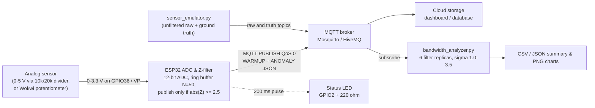

# Edge Anomaly Stream Filter

[](https://www.espressif.com/en/products/socs/esp32)
[](https://docs.espressif.com/projects/arduino-esp32/)
[](https://platformio.org/)
[](https://wokwi.com/)
[](https://www.python.org/)
[](https://mqtt.org/)

**Filter bad sensor telemetry at the edge node before sending.**
Coursework for *Electronic Components and Circuits* (EEAIR), Sulaimanov Baibol ([@CilaNim](https://github.com/CilaNim), handle `cilan1m0`), November 2026.

---

## Research question

> *What streaming anomaly threshold reduces cloud bandwidth by >40% without losing critical events?*

**Short answer.** With the anomaly-gated Z-score filter that this firmware uses, **any threshold σ ≥ 2.0 meets the >40% target in every tested seed with 0 missed critical events**. The recommended threshold is **σ = 2.5**: it is the lowest tested threshold that gave **0 missed events and 0 false alarms** in every run (σ = 2.0 had 19 false alarms over 10 seeds):

| Evidence (σ = 2.5, gated buffer) | Bandwidth reduction | Missed critical events | False alarms |
|---|---|---|---|
| Live 120 s MQTT run through Mosquitto 2.0.11 (seed 42, 1201 samples) | **91.78 %** | **0 / 50** | **0** |
| Offline, 10 seeds × 1200 samples | **90.96 ± 0.84 %** (min 89.37 %) | **0 / 598** | **0** |

The ">90 % reduction" claim holds for the live run and for the 10-seed mean, **but not for every seed**: 8 of 10 seeds exceed 90 %, while the two most spike-rich seeds reach 89.37 % and 89.94 %. Every spike has to be transmitted, so a stream with more anomalies always costs more bandwidth.

---

## Overview

A battery- or bandwidth-limited IoT node that streams every sample to the cloud spends most of its uplink on values that carry no information. This project moves the decision to the edge:

1. An **ESP32 (WROOM-32)** samples an analog voltage on **GPIO36 (VP)** at 10 Hz with its 12-bit ADC.
2. The last **N = 50** samples (5 s) are kept in a **statically allocated ring buffer** (no `new`, `malloc`, `String` or `std::vector`).
3. For every new sample the node computes the window mean μ, the sample standard deviation σ and the **Z-score**.
4. Only samples with **|Z| ≥ 2.5** are published as JSON over **MQTT**. Nominal samples are dropped on the microcontroller.
5. An LED on **GPIO2** pulses for 200 ms whenever an anomaly is published.

A Python 3.10 suite (`sensor_emulator.py`, `bandwidth_analyzer.py`) generates a reproducible test signal, sends it through a real Eclipse Mosquitto broker and measures how many MQTT bytes the filter saves at six thresholds.

### System dataflow



---

## Repository structure

```
edge-anomaly-stream-filter/
├── README.md                       ← this file
├── app.py                          ← interactive web application launcher
├── edge-anomaly.cmd                ← Windows CLI wrapper for app.py
├── platformio.ini                  ← env esp32dev, builds only src/edge_node/
├── wokwi.toml                      ← Wokwi for VS Code: points to the PlatformIO firmware
├── diagram.json                    ← Wokwi circuit: ESP32 DevKitC v4 + pot on VP + LED/220 Ω on GPIO2
├── libraries.txt                   ← library list for the wokwi.com web project
└── src/
    ├── edge_node/
    │   └── main.cpp                ← ESP32 firmware (also works as Wokwi sketch.ino)
    ├── analytical_tools/
    │   ├── sensor_emulator.py      ← signal generator + MQTT publisher
    │   ├── bandwidth_analyzer.py   ← threshold sweep, byte accounting, charts
    │   └── requirements.txt        ← numpy, matplotlib, paho-mqtt
    └── app/
        ├── __init__.py
        ├── server.py               ← HTTP server, simulation & standalone exporter
        └── static/
            ├── index.html          ← 4-tab UI (Wokwi studio, simulator, analysis, explorer)
            ├── styles.css          ← UI styling
            ├── app.js              ← simulation charts & project explorer
            └── wokwi.js            ← interactive circuit & GPIO2 LED simulator
```

---

## Hardware: circuit and pinout

| Signal | ESP32 pin | Component | Notes |
|---|---|---|---|
| Sensor input | **GPIO36 / VP** (ADC1_CH0, input-only) | Sensor output or divider midpoint | `analogReadResolution(12)` → 0…4095, `analogSetPinAttenuation(36, ADC_11db)` for the full 0–3.3 V range |
| Sensor supply (Wokwi) | 3V3 and GND.1 | 10 kΩ potentiometer | Pot VCC → 3V3, GND → GND, wiper (SIG) → VP |
| Anomaly LED | **GPIO2** | 220 Ω → red LED anode, cathode → GND.2 | GPIO2 is also the on-board blue LED on most DevKit boards |
| Serial log | TX / RX (USB) | — | 115200 baud |

**ADC conversion.** `V = raw × 3.3 / 4095`. ADC1 is used on purpose: ADC2 is shared with the Wi-Fi radio and cannot be read while Wi-Fi is active. The linear formula ignores the real ESP32 ADC non-linearity near the rails; `analogReadMilliVolts()` (eFuse-calibrated) is the calibrated alternative. On Arduino-ESP32 core 3.x the `ADC_11db` constant still compiles; newer cores call the same setting 12 dB.

**Front-end for a real 0–5 V sensor.** GPIO36 must never see more than 3.3 V, so a resistive divider is used:

```
 Sensor OUT (0-5 V) ──[ R1 = 10 kΩ ]──┬──► GPIO36 / VP
                                     │
                                [ R2 = 20 kΩ ]   (optional 100 nF VP→GND = anti-alias RC)
                                     │
                                    GND
```

V_VP = V_in · R2 / (R1 + R2) = 5 V · 20 / 30 = **3.33 V** at full scale.

**LED current limiting.** With a red LED (V_f ≈ 2.0 V): I = (3.3 V − 2.0 V) / 220 Ω ≈ **5.9 mA**, well within the GPIO drive capability given in the ESP32 datasheet.

**LED patterns.**

| Pattern on GPIO2 | Meaning |
|---|---|
| Fast blink (100 ms toggle) | No Wi-Fi |
| Slow blink (500 ms toggle) | Wi-Fi OK, MQTT broker not connected |
| Off | Online, nothing to report (warm-up or nominal) |
| 200 ms pulse | An ANOMALY packet was just published |

---

## Algorithm

Sampling runs at 10 Hz (`SAMPLE_PERIOD_MS = 100`) with a non-blocking `millis()` scheduler. For each new sample $x$ the statistics are taken over the $N = 50$ values already in the window ($x$ itself is **not** included):

$$\mu = \frac{1}{N}\sum_{i=1}^{N} x_i \qquad \sigma = \sqrt{\frac{1}{N-1}\sum_{i=1}^{N}(x_i-\mu)^2} \qquad Z = \frac{x-\mu}{\sigma}$$

- **Two-pass statistics in `double`:** the mean first, then the sum of squared deviations (numerically stable; 50 floats are cheap to scan twice).
- **Zero-division guard:** if $\sigma < 0.0001$ the signal is flat and $Z$ is forced to 0 (logged as `[GUARD]`).
- **Warm-up:** while the window holds fewer than 50 samples, every sample is published raw with `"state":"WARMUP"`.
- **Decision:** $|Z| \ge 2.5$ → publish `"state":"ANOMALY"` and pulse the LED; otherwise drop the sample at the node.

**Anomaly-gated window update (default, `GATED_BUFFER_UPDATE = true`).**

| Sample class | Window action | Run counter |
|---|---|---|
| WARMUP | pushed | unchanged |
| NOMINAL (incl. σ-guard case $Z = 0$) | pushed | reset to 0 |
| ANOMALY, run < 10 | **not pushed** (a spike must not inflate μ and σ for the next 5 s) | incremented first |
| ANOMALY, run ≥ `REBASELINE_RUN` = 10 | pushed (re-baseline, logged as `[REBAS]`) | keeps counting |

Ten consecutive anomalies (1 s) are treated as a genuine level shift: from the 10th one on, the samples enter the window so the baseline follows the new level instead of alarming forever. The original "push every sample" policy is kept as `GATED_BUFFER_UPDATE = false` and is reported below as the ablation.

**Why gating matters.** With push-all, past spikes stay in the window and inflate σ. In the 10-seed push-all run the 31 missed spikes at σ = 2.5 had 4–8 other spikes in their window (mean window σ 0.518 V, versus about 0.145 V for a spike-free window). Gating removes that masking.

### MQTT topics and payload

| Topic (`eeair/cilan1m0/edge-node-01/…`) | Publisher | Content |
|---|---|---|
| `telemetry` | ESP32 node | WARMUP + ANOMALY packets (counted as bandwidth) |
| `status` | ESP32 node | retained online / LWT offline, heartbeat every 30 s (not counted) |
| `raw` | `sensor_emulator.py` | unfiltered stream (what a node without filtering would send) |
| `truth` | `sensor_emulator.py` | sequence numbers of injected spikes (ground truth, not counted) |

Example ANOMALY payload produced by the firmware filter core (host-test serial log, 115 B):

```json
{"node":"edge-node-01","seq":98,"t_ms":9800,"raw":3960,"v":3.191,"mu":1.641,"sd":0.152,"z":10.20,"state":"ANOMALY"}
```

`seq` counts every sample, so gaps in `seq` on the telemetry topic are the dropped nominal samples. WARMUP packets keep the same keys with `"mu":0.000,"sd":0.000,"z":0.00` (111–113 B). Bytes per message are counted as the size of the MQTT 3.1.1 PUBLISH packet at QoS 0: fixed header (1 B + remaining-length varint) + 2 + topic length + payload length.

---

## Reproduction

### Live simulation in Wokwi (web, no installation)

The simulation is defined entirely by files in this repository, so it can be recreated in two minutes:

1. Open [wokwi.com](https://wokwi.com/), sign in, and start a new **ESP32** project.
2. Replace the contents of `sketch.ino` with `src/edge_node/main.cpp`.
3. Replace the contents of `diagram.json` with this repository's `diagram.json` (ESP32 DevKitC v4, potentiometer on VP, LED + 220 Ω on GPIO2).
4. Add the libraries from `libraries.txt` through the **Library Manager**: `PubSubClient` and `ArduinoJson`.
5. Press **Start**. The node joins `Wokwi-GUEST` and connects to `broker.hivemq.com:1883`.
6. Watch the traffic from any PC with Mosquitto installed:

   ```bash
   mosquitto_sub -h broker.hivemq.com -p 1883 -t 'eeair/cilan1m0/edge-node-01/#' -v
   ```

7. Optionally measure the bytes the node really publishes:

   ```bash
   cd src/analytical_tools
   python bandwidth_analyzer.py --live-topic --host broker.hivemq.com --duration 120
   ```

**Expected behaviour in Wokwi.** The Wokwi potentiometer produces a perfectly noise-free value. After the 50 WARMUP packets the window is flat, σ ≈ 0, and the zero-σ guard (σ < 0.0001 → Z = 0) keeps the node **silent** — the Serial monitor shows `[GUARD]` and `[DROP ]` lines. Turning the knob quickly produces `[ALERT]` packets and LED pulses. Because the window is flat, the first changed sample still hits the guard, so the first alert appears one sample (100 ms) after the move. A sustained new knob position is alerted for about 1.5 s (in a host test of a flat-to-step input: 15 alerts, `[REBAS]` from the 10th) and then absorbed as the new baseline. Turning the knob slowly raises σ together with the signal, so slow turns are not reported — this is the adaptive behaviour of the Z-score.

### PlatformIO + Wokwi for VS Code

```bash
pio run -e esp32dev                 # build (only src/edge_node/ is compiled)
pio run -e esp32dev -t upload       # flash a real ESP32
pio device monitor -b 115200        # Serial log
```

In VS Code with the Wokwi extension: build first, then run **"Wokwi: Start Simulator"**; `wokwi.toml` points to `.pio/build/esp32dev/firmware.bin|elf` and the circuit comes from `diagram.json`. For real hardware set `WIFI_SSID`, `WIFI_PASSWORD`, `WIFI_CHANNEL = 0` and `MQTT_HOST` (IP of the PC running Mosquitto) at the top of `main.cpp`.

Verified build (`esp32dev`, espressif32 8.0.0, Arduino-ESP32 core 3.3.12): **RAM 14.7 % (48 088 B of 327 680 B), Flash 76.3 % (999 544 B of 1 310 720 B), 0 warnings.** It also builds on core 2.0.17 (RAM 14.0 %, Flash 58.3 %). The ring buffer itself uses 50 × 4 B = 200 B of RAM.

### Python experiment with Eclipse Mosquitto

```bash
python3.10 -m venv .venv && source .venv/bin/activate
pip install -r src/analytical_tools/requirements.txt
```

Start a local broker with a minimal `mosquitto.conf`:

```
listener 1883 127.0.0.1
allow_anonymous true
```

```bash
mosquitto -c mosquitto.conf &
mosquitto_sub -h localhost -p 1883 -t 'eeair/cilan1m0/edge-node-01/#' -v > mosquitto_sub_traffic.log &

cd src/analytical_tools
# live experiment: analyzer first, emulator 2 s later (125 s, so it outlasts the 120 s window)
python bandwidth_analyzer.py --host localhost --port 1883 --seed 42 --duration 120 &
python sensor_emulator.py   --host localhost --port 1883 --seed 42 --duration 125

# offline statistics (no broker needed)
python bandwidth_analyzer.py --offline --seeds 1 2 3 4 5 6 7 8 9 10 --duration 120
python bandwidth_analyzer.py --offline --seed 42 --duration 120 --name threshold_sweep_offline_seed42 --no-chart --trace
python bandwidth_analyzer.py --offline --compare-policies --seeds 1 2 3 4 5 6 7 8 9 10 --duration 120
python bandwidth_analyzer.py --robustness --seed 42
python bandwidth_analyzer.py --robustness --seeds 1 2 3 4 5 6 7 8 9 10 --name robustness_seeds --no-chart
```

Use `--policy all` to rerun any experiment with the push-all ablation. Without a broker, `python bandwidth_analyzer.py --offline --seed 42` reproduces the same alerts as the live run.

**Test signal** (`sensor_emulator.py`, defaults): 10 Hz; 1.65 V + 0.20 V · sin(2π · 0.5 Hz · t); Gaussian noise σ_n = 0.03 V; each sample becomes a spike with probability 5 % (±1.2…1.8 V, random sign), clipped to 0…3.3 V and quantised like the 12-bit ADC. A **critical event** is an injected spike after warm-up.

---

## Results

All numbers below are recorded from running `bandwidth_analyzer.py` (`--offline` / `--host`, writing CSV/JSON and PNG charts on demand). The baseline is "send every sample in the same telemetry JSON".

### Live MQTT run — seed 42, 120 s, 1201 samples, gated buffer

Real Mosquitto 2.0.11 broker, 0 lost sequence numbers, 50 critical events after warm-up. Baseline: 1201 messages / 190 447 B.

| σ threshold | Messages | Bytes sent | Reduction % | Detected | Missed | FNR % | False positives | Precision % |
|---|---|---|---|---|---|---|---|---|
| 1.0 | 796 | 126 153 | 33.76 | 50 | 0 | 0.00 | 696 | 6.70 |
| 1.5 | 578 | 91 680 | 51.86 | 50 | 0 | 0.00 | 478 | 9.47 |
| 2.0 | 101 | 15 810 | 91.70 | 50 | 0 | 0.00 | 1 | 98.04 |
| **2.5** | **100** | **15 652** | **91.78** | **50** | **0** | **0.00** | **0** | **100.0** |
| 3.0 | 100 | 15 652 | 91.78 | 50 | 0 | 0.00 | 0 | 100.0 |
| 3.5 | 100 | 15 652 | 91.78 | 50 | 0 | 0.00 | 0 | 100.0 |

Messages include the 50 WARMUP packets. Measured against the smaller 5-key payload actually carried on the `raw` topic, the σ = 2.5 reduction is 87.24 %.

### Offline statistics — seeds 1..10, 1200 samples each, gated buffer

598 critical events in total.

| σ threshold | Reduction % (mean ± std) | Worst seed % | Missed / 598 | Seeds with 0 missed | False positives (total) | Precision % (mean) |
|---|---|---|---|---|---|---|
| 1.0 | 32.73 ± 4.05 | 26.67 | 0 | 10/10 | 6971 | 7.9 |
| 1.5 | 55.51 ± 7.56 | 39.11 | 0 | 10/10 | 4245 | 12.7 |
| 2.0 | 90.80 ± 0.93 | 89.20 | 0 | 10/10 | 19 | 97.1 |
| **2.5** | **90.96 ± 0.84** | **89.37** | **0** | **10/10** | **0** | **100.0** |
| 3.0 | 90.96 ± 0.84 | 89.37 | 0 | 10/10 | 0 | 100.0 |
| 3.5 | 90.96 ± 0.84 | 89.37 | 0 | 10/10 | 0 | 100.0 |

At σ = 2.5, 8 of 10 seeds exceed 90 %; seed 3 (79 spikes) gives 89.37 % and seed 4 (72 spikes) gives 89.94 %. σ = 2.5, 3.0 and 3.5 are identical here because, once σ is no longer inflated, every spike has |Z| well above 3.5.

### Policy ablation — gated vs push-all, 10-seed means

| σ threshold | Reduction gated % | Reduction push-all % | FNR gated % | FNR push-all % | Missed gated / push-all | False positives gated / push-all |
|---|---|---|---|---|---|---|
| 1.0 | 32.73 | 86.62 | 0.00 | 0.00 | 0 / 0 | 6971 / 522 |
| 1.5 | 55.51 | 90.44 | 0.00 | 0.00 | 0 / 0 | 4245 / 64 |
| 2.0 | 90.80 | 91.01 | 0.00 | 0.72 | 0 / 5 | 19 / 0 |
| **2.5** | **90.96** | **91.23** | **0.00** | **4.61** | **0 / 31** | **0 / 0** |
| 3.0 | 90.96 | 91.72 | 0.00 | 13.95 | 0 / 90 | 0 / 0 |
| 3.5 | 90.96 | 92.37 | 0.00 | 26.52 | 0 / 168 | 0 / 0 |

Gating costs about 0.3 percentage points of bandwidth at σ = 2.5 (the 31 spikes push-all misses are now sent) and removes every missed event. Below σ = 2 gating backfires (see Limitations).

### Robustness at σ = 2.5 (seed 42)

| Scenario | Policy | Spikes | Missed (clipped at 3.3 V rail) | False positives | Reduction % | Re-baseline time |
|---|---|---|---|---|---|---|
| Reference, 120 s | gated | 50 | 0 (0) | 0 | 91.77 | — |
| Drift +0.15 V/min, 10 min | gated | 274 | 29 (29) | 0 | 95.11 | — |
| Drift +0.15 V/min, 10 min | push-all | 274 | 57 (56) | 0 | 95.58 | — |
| Step +0.8 V at 60 s | gated | 50 | 0 (0) | 12 | 90.77 | 1.2 s |
| Step +0.8 V at 60 s | push-all | 50 | 3 (3) | 2 | 91.86 | 0.2 s |

Slow drift causes no false alarms; every spike the gated filter misses during drift is an upward spike clipped at the 3.3 V ADC rail once the baseline has drifted to about 2.9 V. A sustained +0.8 V step is reported as ~12 alerts and absorbed into the baseline after 1.2 s. Over seeds 1..10 the gated step scenario averages 11.5 flagged samples and 1.17 s re-baseline time.

### Verification

- **Host unit tests** of the filter core extracted verbatim from `main.cpp`: 20/20 passed (ring-buffer wrap, warm-up, σ guard, sample σ, gating, re-baseline, JSON format).
- **C++ vs Python twin:** the firmware core and the analyzer's filter replica were compared on 110 400 decisions (several streams × 6 thresholds × 2 policies) with **0 differences** in state, window action, μ/σ/Z or JSON.
- **Byte accounting vs broker:** for 2000 test packets the formula predicted 205 718 B; Mosquitto's `$SYS/broker/bytes/received` grew by 205 790 B (the 72 B difference is the clients' CONNECT/SUBSCRIBE/DISCONNECT).
- **Live = offline:** the offline seed-42 run with 1201 samples gives exactly the same alerts as the live MQTT run.

---

## Limitations

- **Synthetic signal.** The results are for the emulator model (5 % spike rate, spikes of 1.2–1.8 V against a window σ of about 0.145 V). Smaller anomalies or a different anomaly rate change both the reduction and the miss rate.
- **Reduction depends on the anomaly rate.** Every spike must be sent, so the achievable reduction is capped at roughly 1 − (50 + spikes)/1200 in a 2-minute window — hence 89.37 % for the most spike-rich seed.
- **Cold start.** The 50 warm-up packets (7 729 B for seed 42) are about half of the σ = 2.5 traffic in a 120 s window, and spikes during warm-up are sent raw but not flagged. Longer runs amortise this: the 10-minute drift run reaches 95.11 %.
- **Variance collapse at low thresholds.** With gating, σ ≤ 1.5 keeps normal sine peaks out of the window, σ shrinks, and the node floods false alarms (σ = 1.0: 32.73 %, misses the 40 % target; σ = 1.5: worst seed 39.11 %). Use σ ≥ 2.0 with the gated policy.
- **Slow drift is not reported.** The 5 s window follows a slow drift; this is a spike detector, not a drift alarm.
- **ADC rail clipping.** Upward spikes cannot exceed 3.3 V; when the baseline is near the rail they become invisible. Bias the sensor to mid-scale and keep divider headroom.
- **Step response.** A real event lasting longer than ~1 s is partly absorbed into the baseline (trade-off set by `REBASELINE_RUN`).
- **Byte accounting.** QoS 0 PUBLISH sizes only (no TCP/IP overhead); heartbeats and ground-truth topics are excluded. The localhost run had no loss; QoS 0 over Wi-Fi/WAN can drop packets.
- **Wokwi.** The simulated potentiometer has no noise, so the node stays quiet after warm-up until the knob moves (zero-σ guard). This is expected behaviour, not a fault.
